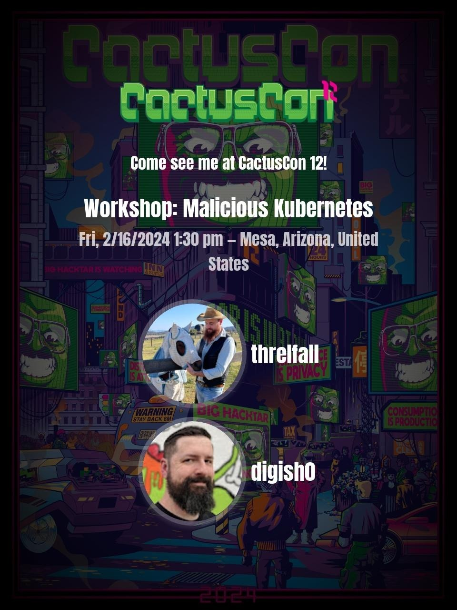

# Malicious Kubernetes Workshop

This directory contains the current version of the Malicious Kubernetes workshop materials. The workshop is an introduction to Kubernetes and container security — covering cluster deployment, offensive container techniques, privilege escalation, supply chain security, and runtime detection with modern eBPF-based tools.

## Quick Start

1. **[Lab Setup](lab-setup.md)** — Environment setup (GCP VM, tooling, kind cluster)
2. **[Lab Walk-Through](labs_walk_thru.md)** — Step-by-step lab instructions for all modules
3. **[Cheat Sheet](cheatsheet.md)** — Troubleshooting and quick reference

## What's Covered

| Module | Topic |
|--------|-------|
| 1 | Docker fundamentals |
| 2 | Exploring container images & reverse engineering |
| 3 | Offensive Docker techniques (exfil, socket hijacking, persistence) |
| 4 | Container incident response CTF |
| 5 | Kubernetes 101 |
| 6 | Kubernetes security — RBAC abuse, priv esc, golden tickets, evil pods |
| 7 | Supply chain security — cosign, syft, grype, image provenance |
| 8 | Modern runtime security — Tracee, Falco, Tetragon |
| 9 | Cloud-native & managed K8s attacks — IMDS, workload identity, network policy bypass |

## Tools Used

- **Infrastructure**: kind, kubectl (v1.31), Helm v3, Ansible
- **Observability**: Prometheus, Grafana, Loki, Promtail
- **Runtime Security**: Tracee, Falco (+Falcosidekick), Tetragon
- **Supply Chain**: cosign, crane, syft, grype
- **Offensive**: ngrok, openssl, nmap, socat

## Presenters

### Instructor: David Mitchell

> [@digish0](https://twitter.com/digish0)\
> https://digital-shokunin.net

### Instructor: Adrian Wood

> [@whitehacksec](https://twitter.com/WHITEHACKSEC)\
> https://5stars217.github.io

## Our lockpick/hacker(space) group

